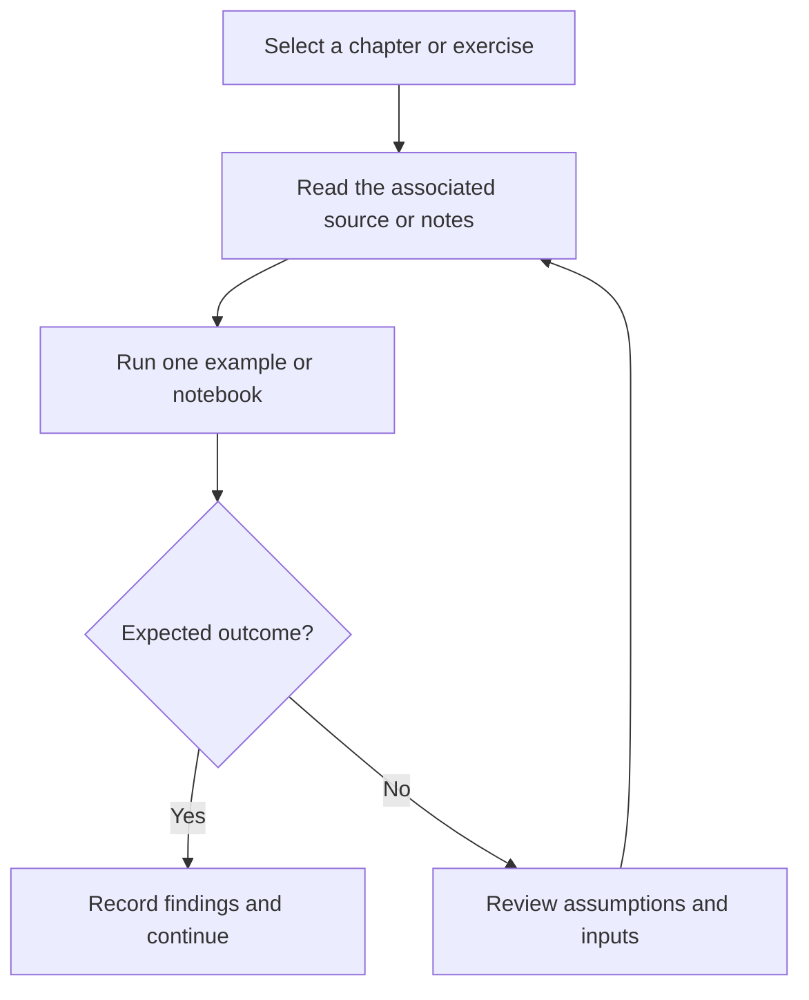

# JavaScript Fundamentals and Browser Projects

JavaScript learning examples covering variables, control flow, functions, DOM manipulation, events, and small projects.

## Project focus

Learning / reference collection. Use the directory map to choose a focused example or learning topic instead of treating the repository as one application.

## Workflow



The diagram describes how to work through the material; it is not a deployed service topology.

## Repository structure

| Path | Purpose |
| --- | --- |
| [`DOM/`](DOM) | Project-specific source, resources, or learning material. |
| [`Events/`](Events) | Project-specific source, resources, or learning material. |
| [`Function-Methods/`](Function-Methods) | Project-specific source, resources, or learning material. |
| [`Loops-Strings/`](Loops-Strings) | Project-specific source, resources, or learning material. |
| [`Operators-Conditions/`](Operators-Conditions) | Project-specific source, resources, or learning material. |
| [`Projects/`](Projects) | Project-specific source, resources, or learning material. |
| [`Variables-Datatypes/`](Variables-Datatypes) | Project-specific source, resources, or learning material. |

## Getting started

```bash
git clone https://github.com/Raimal-Raja/JavaScript.git
cd JavaScript
```

```bash
python -m venv .venv
source .venv/bin/activate
```

On Windows PowerShell, activate the environment with `.venv\Scripts\Activate.ps1` instead.

Read an individual chapter or source file and run its examples independently. There is no single shared application entry point. Install only the dependencies used by the example you select.

## Verification

Use the setup commands and inspect the selected interface, example, or notebook with known inputs. This documentation review checks repository paths and dependency declarations; it does not claim fresh end-to-end execution or model-quality measurements.

## Contributing

Include reproduction steps, the affected path, expected behavior, and the checks you ran. Keep credentials, generated environments, and unnecessary build artifacts out of commits.

## License

No top-level license file is currently tracked. Check reuse permissions with the repository owner.
